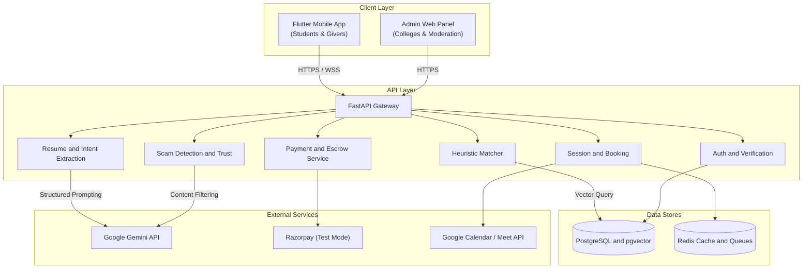

# WarmPath System Architecture & Design

This document details the technical design, data flows, and service contracts for the WarmPath platform.

## High-Level Component Topology

## Detailed Service Responsibilities

### 1. Identity & Verification Service
- Validates institutional domains and checks against pre-loaded enrollment / roll number rosters.
- Issues JWTs with embedded trust levels (`New`, `Verified`, `Established`, `Restricted`).
- For recruiters, handles business identification checks (CIN or GST records).

### 2. Resume & Intent Extraction Service
- Ingests uploaded PDF resumes with explicit student consent under India's DPDP Act.
- Calls the Gemini API with a deterministic JSON schema to parse:
  - Technical and domain skills
  - Project summaries and tech stacks
  - Education history
- Exposes parsed fields back to the student for confirmation and manual correction.
- Takes the single intent prompt: `"What do you want next?"` (e.g., frontend internship, GRE guidance, startup cofounder).
- Generates 768-dimensional text embeddings for the combined profile and stores them in PostgreSQL with `pgvector`.

### 3. Heuristic Matching Service
Computes recommendations using a transparent multi-factor formula rather than an opaque black box.

$$\text{Score} = 0.35E + 0.25I + 0.15A + 0.10C + 0.10R + 0.05O$$

Where:
- $E$ (Expertise Fit): Cosine similarity between resume embeddings and giver offerings.
- $I$ (Intent Fit): Cosine similarity between the student's stated goal and the giver's declared mentoring topics.
- $A$ (Affinity): Categorical match on same college, department, or student society.
- $C$ (Availability): Real-time availability indicator and open slots remaining within the weekly quota.
- $R$ (Rating Band): Scaled performance multiplier based on verified historical ratings.
- $O$ (Response Odds): Historical acceptance rate and turnaround speed.

**Hard Filters**:
- Accounts marked `Restricted` are never recommended.
- Givers who have reached their weekly session cap are excluded from slot discovery.

### 4. Scheduling & Call Relay
- Connect Now: Checks active 30-minute availability windows in Redis.
- Booked Slots: Generates calendar invites via Google Calendar API or temporary in-app WebRTC / Jitsi room links.
- Masks personal email addresses and telephone numbers from both ends.

### 5. Escrow & Credit Accounting
- Maintains a double-entry ledger of credits.
- Reserves session credit upon booking.
- Releases payouts or credit transfers only after a completed call verification (minimum meeting duration confirmed) and when the 48-hour dispute window has passed without escalation.
